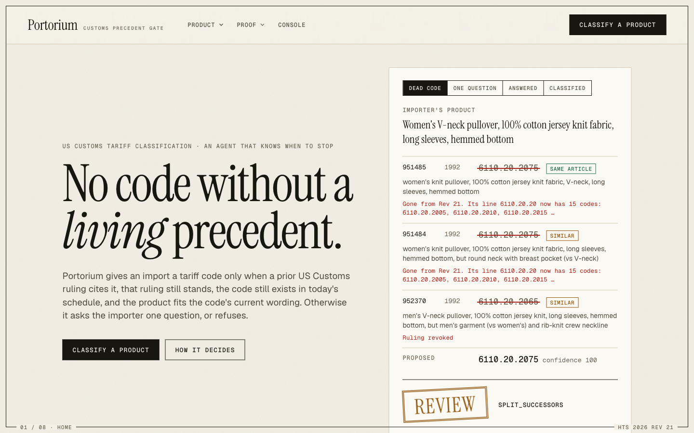
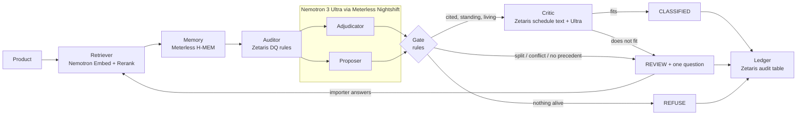

<div align="center">



&nbsp;

[](LICENSE)


### No code without a living precedent. The model may suggest a code; it never gets to give one.

Portorium classifies imports under the US tariff schedule. It gives a 10-digit code only when a prior US Customs ruling cites it, that ruling still stands, the code still exists in **HTS 2026 Revision 21**, and the product fits the code's current wording. Otherwise it asks the importer one question, or refuses. **Zetaris** decides what is alive, **Meterless Nightshift** routes every reasoning call to **NVIDIA Nemotron**, and **Meterless H-MEM** remembers what brokers and importers told it.

**[ Judge it in 90 seconds ↓ ](#judge-it-in-90-seconds)** · **[ Evidence ↓ ](#evidence)** · **[ How it decides ↓ ](#what-portorium-is)** · **[ Run it live ↓ ](#run-it-live)**

<!-- LIVE_AND_VIDEO_LINKS -->

</div>

## ▶ Demo

<!-- DEMO_VIDEO -->

A women's V-neck pullover. The closest CBP ruling is a 1992 exact match, and Nemotron 3 Ultra proposes its code with **confidence 100**. Zetaris answers that `6110.20.2075` is no longer in the schedule, so the gate refuses to give it and lists the codes its line carries now. A polo shirt comes next: its code is alive, but the Critic reads the schedule's current wording and asks the one fact it needs, the fibre. The importer answers, the whole loop runs again, and the verdict is stamped CLASSIFIED with three Nightshift receipts. H-MEM keeps the answer for the next shipment.

## Contents

[The problem I set out to solve](#the-problem-i-set-out-to-solve) · [What Portorium is](#what-portorium-is) · [Judge it in 90 seconds](#judge-it-in-90-seconds) · [Evidence](#evidence) · [Architecture](#architecture) · [How I integrated the sponsors](#how-i-integrated-the-sponsors) · [The verdict vocabulary](#the-verdict-vocabulary) · [Engineering decisions and the hard problems](#engineering-decisions-and-the-hard-problems) · [What's real: the honesty table](#whats-real-the-honesty-table) · [Run it live](#run-it-live) · [Tests and layout](#tests-and-layout) · [AI and model usage](#ai-and-model-usage) · [Data, licences, pre-existing work](#data-licences-and-pre-existing-work)

## The problem I set out to solve

Most classification tools answer one question: *which code fits this product?* Portorium answers the harder one: **is that code still alive, and does it still mean what the precedent meant?**

The 2026 US tariff schedule is already on its 21st revision. Codes are split, renumbered and deleted, and rulings are revoked. A model asked for a code from memory names one that is not in the current schedule for a large share of products, and copying the closest prior ruling's code fails the same way (numbers [below](#evidence)). Worse, a code can survive a revision while what it covers moves: in Rev 21, `3004.90.92.35` reads *"Containing tramadol"*, while a 2023 CBP ruling used it for olanzapine, which now has its own line. Checking that a code exists is not enough.

So I treated *"the code is dead or has changed meaning"* as a first-class failure, next to *"the code is wrong"*, and built the agent around refusing both.

## What Portorium is

Eight roles in one request. A model proposes; Zetaris and a second model verify; plain code decides.

| # | Role | Runs on | Does |
|---|---|---|---|
| 1 | **Retriever** | NVIDIA Nemotron 3.5 Embed 1B + Rerank 8B | finds the six closest CBP rulings issued before the question date (56,371 indexed) |
| 2 | **Memory** | Meterless H-MEM | recalls a broker's sign-off or the importer's earlier answer for a similar product |
| 3 | **Auditor** | Zetaris | one query per request: is each ruling revoked, is each code living, split or removed in Rev 21 |
| 4 | **Adjudicator** | Nemotron 3 Ultra via Nightshift | same article, similar or different, for each precedent; one question if they disagree |
| 5 | **Proposer** | Nemotron 3 Ultra via Nightshift, in parallel with 4 | one code, only from codes the retrieved rulings cite, with a confidence |
| 6 | **Gate** | Python rules | the code must be cited by a standing ruling judged the same or a similar article, and be living |
| 7 | **Critic** | Zetaris schedule text + Nemotron 3 Ultra | the code's Rev 21 wording at every level, with the alternatives at each level: does the product fit? |
| 8 | **Importer · Broker** | a person | answers the one question (the loop runs again) or signs off (stored in H-MEM) |

Every verdict names the rule that decided it and carries a Nightshift receipt for every model call. Every step writes one line to `logs/trace-<run>.jsonl` and stdout as it happens: role, handoff, model, retries, status. The site's **Traces** page replays any run line by line.

## Judge it in 90 seconds

Sample mode replays the recorded responses of NVIDIA, Nightshift and Zetaris for the documented inputs and runs the gate's own logic on them. No keys, no accounts, no services.

```bash
git clone https://github.com/Cassxbt/portorium && cd portorium
python3 run.py                     # builds .venv, installs, opens the site and console at http://127.0.0.1:8781
```

Or straight from the command line:

```bash
python3 run.py classify "Women's V-neck pullover, 100% cotton jersey knit fabric, long sleeves, hemmed bottom"
```

```text
  trace Auditor.check_liveness -> Adjudicator success: 951484 6110202075 split; 951485 6110202075 split; 952370 REVOKED ...
  trace Proposer.propose -> Gate [nvidia/nemotron-3-ultra-550b-a55b] success: 6110202075 at confidence 100
  trace Gate.decide -> Broker needs_review: REVIEW SPLIT_SUCCESSORS

REVIEW  [SPLIT_SUCCESSORS]
  951485      1992-08-11  full     6110.20.2075  split   code_in_schedule  women's knit pullover, 100% cotton jersey knit fabric, V-neck, ...
      gone from Rev 21; its line 6110.20.20 now has 15 codes: 6110.20.2005, 6110.20.2010, 6110.20.2015, ...
  951484      1992-08-11  partial  6110.20.2075  split   code_in_schedule  women's knit pullover, 100% cotton jersey knit fabric, ...
      gone from Rev 21; its line 6110.20.20 now has 15 codes: 6110.20.2005, 6110.20.2010, 6110.20.2015, ...
  952370      1992-09-22  partial  6110.20.2065  revoked ruling_revoked  men's V-neck pullover, 100% cotton jersey knit, ...
```

| Try | Expect |
|---|---|
| `python3 run.py classify "Portable Bluetooth party speaker with two drivers in one enclosure, rechargeable battery, LED lights"` | CLASSIFIED `8518.22.0000`; the Critic confirms "multiple loudspeakers" |
| `python3 run.py classify "Men's knitted polo shirt with short sleeves and a three-button placket"` | REVIEW `SCHEDULE_TEXT_DISAGREES`: what is the fibre? Answer `100% cotton jersey knit` at the prompt for CLASSIFIED `6105.10.00.10` |
| `python3 run.py test` | the test suite, including the official Meterless H-MEM conformance vectors |

Needs Python 3.12; with [uv](https://docs.astral.sh/uv/) installed, `run.py` fetches it on its own. The inputs are in `input_examples/`, their real outputs and traces in `output_examples/`. Any other product needs live mode. After answering or signing off, `python3 run.py forget` resets memory so the recorded requests match again.

## Evidence

<!-- EVAL_TABLES -->

**Method.** Items are CBP "Classification" rulings from 2026 that cite exactly one 10-digit code; that code is the answer. Every system sees the same product description with all tariff numbers, chapter references and ruling numbers removed (`portorium/leakage.py`, checked for every item by `tests/test_eval_inputs.py`). Precedent search returns only rulings issued before the split starts, and never the ruling itself or one it cites. Accuracy counts exact 10-digit matches on the items a system answers, with 95% Wilson intervals; the stale-code rate is the share of answers that are not a living line of HTS 2026 Rev 21, checked against the Zetaris schedule. The Proposer-alone, confidence-threshold and without-Critic rows come from the same calls on the same items as the gate, so each difference is one layer. Every system is scored on the same items. Tables are generated from the run files by `scripts/eval_table.py`.

**Run once, on a seeded sample.** `data/eval/TEST_RUN.lock` records the test file's sha256, the commit and the hash of every prompt when the test run started, and every resume. NVIDIA's rate limit held the run to under one ruling a minute, so it was scored on a seeded random **300 of the 684** test rulings: `load_items("test", 300)`, seed 20261025, fixed in code since 25 October, decided before any test result was read. A first attempt was aborted for a pacing bug, also before any result was read; the lock keeps it with its reason (its text says 7 items, its own count says 6; the count is right). Every step is written up in `data/eval/TEST_RUN_NOTES.md`.

### The number I corrected in public

The first gate let the Adjudicator's "same article" judgement decide. On the dev set it lost to a plain confidence threshold on Nemotron Ultra's own pick, at the same coverage. I kept the runs and rebuilt the gate around what the data showed:

| Dev design, 150 rulings | Coverage | Exact 10-digit accuracy | Confidence threshold, same coverage |
|---|---|---|---|
| v1: the Adjudicator's same-article judgement decides | 24.7% | 45.9% (17/37) | 59.5% |
| v2: a stricter definition of "same article" | 16.0% | 50.0% (12/24) | 70.8% |
| **v3: Proposer + Zetaris liveness + Critic** (replayed on v2's stored calls) | **40.0%** | **73.3% (44/60)** | 48.3% |

`python scripts/design_history.py` reproduces all three rows from the files in `data/eval/history/`, with no service calls. The shipped gate is v3; the frozen test above is a full run of the shipped code.

## Architecture



The trust boundary is the Gate: nothing a model writes becomes a verdict without passing rules that read Zetaris. The Critic can only send a case to review, never classify on its own.

## How I integrated the sponsors

| Sponsor | What it does in Portorium | Where |
|---|---|---|
| **Zetaris** | USL `portorium` holds the schedule (`hts_line`, `hts_code`), the rulings (`ruling`, `ruling_code`) and `hts_release`, a REST table reading the live USITC release; USL `audit` holds `verdict_log`. Liveness is two registered data-quality rules, `code_in_schedule` and `parent_survives`, cross-checked at start-up against their own invalid records. One query per request returns each precedent's revocation and code status. For the Critic, one SQL query walks the loaded schedule's indentation and returns a code's full wording with the alternatives at each level. Live verdicts are written back; `classified_code_living` and `release_is_snapshot` re-screen them. Across 75,870 ruling codes: 53,723 living, 7,938 split, 14,209 removed. | `scripts/zetaris_usl.sql`, `portorium/liveness.py`, `portorium/audit.py`, `portorium/zetaris.py` |
| **Meterless Nightshift** | Every reasoning call: Adjudicator, Proposer, Critic, and the Lightning baseline. Each answer's receipt (`routed_model`, `receipt_id`) stays on the verdict and in the trace. Evaluation requests carry a run tag and the answer cache is set to 0%, so no answer is replayed from an earlier run. | `portorium/nightshift.py` |
| **Meterless H-MEM** | The memory engine (Python port of the reference, Apache-2.0): broker sign-offs and importer answers as long-term factual memories with provenance, recalled for similar products and judged like precedents; wipes are logged in its ledger. `pytest tests/test_hmem_conformance.py` runs the 13 official vectors from `Meterless/Meterless@1742dec` plus a mutation test that shows they catch a broken port. | `portorium/engines/hmem.py`, `portorium/memory.py` |
| **NVIDIA Nemotron** | `nemotron-3.5-embed-1b` (one 2048-d vector per ruling) and `nemotron-3.5-rerank-8b` retrieve; `nemotron-3-ultra-550b-a55b` is the Adjudicator, Proposer and Critic; `nemotron-3.5-lightning-30b-a3b` is a baseline. Embed and Rerank call NVIDIA's API directly: on Nightshift M1–M4 0.92.3, `POST /v1/embeddings` answers `501 route_not_implemented` ("not served in the web build"), re-checked 26 October. Every reasoning call goes through Nightshift. | `portorium/nvidia.py`, `portorium/index.py`, `portorium/gate.py` |

Remove Zetaris and the gate has nothing to stand on: no liveness, no revocations, no schedule text for the Critic. Remove Nightshift and no role can reason. Remove H-MEM and a broker's correction is forgotten by the next shipment.

## The verdict vocabulary

Every verdict is one decision and one rule name, checked in this order. Judges, brokers and code can branch on the name.

| Verdict | Rule | When |
|---|---|---|
| REFUSE | `NO_PRECEDENT_FOUND` | no ruling was found |
| REVIEW | `NO_PRECEDENT_FOR_PROPOSAL` | no retrieved ruling judged relevant cites the proposed code |
| REVIEW | `SPLIT_SUCCESSORS` | the code is gone but its 8-digit line survives; the codes on it now are listed |
| REVIEW | `STALE_PROPOSAL` | the code is gone or its ruling revoked, but another living candidate exists |
| REFUSE | `STALE_PRECEDENT` | the code is gone or revoked, and nothing living remains |
| REVIEW | `MEMORY_CONFLICT` | a broker's remembered decision for the same article names a different code |
| REVIEW | `SCHEDULE_TEXT_DISAGREES` | the code is alive, but the product falls outside its current wording; the Critic's question is attached |
| CLASSIFIED | `LIVING_PRECEDENT` / `BROKER_MEMORY` | a standing, relevant ruling (or a broker's sign-off) cites the code, it is living, and the Critic agrees |

## Engineering decisions and the hard problems

**A living code can still mean something else.** Liveness alone missed renumbered statistical lines, so the Critic reads the code's current wording. The schedule keeps its hierarchy only as indentation, so a single Zetaris query reconstructs each level's line and its alternatives. Where the indentation skips a level, the naive "last line at each level" picks a line from an earlier heading; the query keeps an ancestor only if it comes after every ancestor above it. Checked against an independent tree walk on all 19,949 ten-digit lines, then live in Zetaris on the 27 codes that used to fail.

**Never fake a number; correct it.** The first gate lost to a confidence threshold on dev, so the README shows that run next to the redesign. The frozen test was restarted once, and the lock says why.

**Recorded, not mocked.** Sample mode replays service responses keyed by a hash of each request, so the gate's code runs for real. Even each search's candidate list is recorded, because float32 dot products are not bit-identical across machines and the rerank request depends on the order.

**Zetaris sessions expire with a 400, not a 401.** A 15-minute token expiry returns `{"msg":"Bad Request"}`, while real SQL errors carry a message; the client renews before expiry, re-logs in on exactly that body, and does so under a lock shared by the parallel roles.

**Parallel roles, one trace.** The Adjudicator and Proposer run concurrently; each thread carries the request's trace context, so lines land in the right file with the right role. The recorder loads under a lock so the first parallel replays never see a half-filled cache (a race an adversarial review caught).

**Rate limits are not timeouts.** Only HTTP 429 slows every worker down; timeouts and server errors are retried without throttling the rest. Getting this wrong cost the first test attempt.

## What's real: the honesty table

| Capability | Status |
|---|---|
| Zetaris liveness, revocations, schedule text, audit write-back | **Real.** Live SQL against a Zetaris 2.4.3.1 instance (local Docker edition in a GitHub Codespace). |
| Every reasoning call through Meterless Nightshift with receipts | **Real.** Nightshift M1–M4 0.92.3 on a MacBook Air M1, NVIDIA cloud lanes. |
| Retrieval with Nemotron Embed and Rerank | **Real**, called on NVIDIA's API directly (Nightshift's embeddings route returns 501). |
| H-MEM broker memory | **Real** Python port of the reference, passing the official vectors; persisted per importer as JSON. |
| Sample mode | **Recorded** responses for the documented inputs; the gate's logic runs on them. Other inputs need live mode. |
| Evaluation | **Real** runs on 2026 CBP rulings; single-code rulings only, CBP's code as the answer; wide intervals at these sizes. |
| Schedule revisions | One revision loaded at a time (Rev 21). A newer USITC release is flagged by a rule, not loaded automatically. |
| Precedent sources | US CBP rulings only. Court decisions and other authorities' rulings are not consulted. |
| Legal effect | **Advisory.** A licensed broker decides; no broker queue yet (not built, never faked). |

## Run it live

| Service | Setup |
|---|---|
| NVIDIA | `NVIDIA_API_KEY` in `.env` (Embed and Rerank). |
| Meterless Nightshift | the Nightshift app with Nemotron 3 Ultra and 3.5 Lightning lanes; the token is read from Nightshift's runtime-token file (`NIGHTSHIFT_TOKEN_FILE` to override). Set answer caching to 0% for evaluation runs. |
| Zetaris | a Zetaris instance with the `portorium` USL: `python scripts/build_zetaris_inputs.py data/cross/rulings.jsonl`, then `python scripts/load_zetaris.py` (statements in `scripts/zetaris_usl.sql`). `ZETARIS_URL`, `ZETARIS_USERNAME`, `ZETARIS_PASSWORD` in `.env`. |

```bash
cp .env.example .env                                    # fill in
python3 run.py --live                                   # the console against live services
.venv/bin/portorium classify "<product>" --importer acme
.venv/bin/portorium confirm "<product>" 6110.20.2079 --broker NAME --importer acme
.venv/bin/portorium rescreen                            # Zetaris re-checks the live release and past verdicts
.venv/bin/python scripts/run_eval.py dev --sample 150 --workers 8
```

Data sources and how to regenerate them: [`data/README.md`](data/README.md).

## Tests and layout

`python3 run.py test` runs 62 tests: the gate's rules, the Critic and its schedule text, trace roles and concurrency, recorder replay under parallel load, search replay, evaluation leakage and resume, Zetaris session renewal, and the official H-MEM conformance vectors with a mutation test.

```
portorium/      gate.py (roles + rules), liveness.py, index.py, nightshift.py, nvidia.py, zetaris.py,
                memory.py, engines/hmem.py, trace.py, recorder.py, audit.py, eval.py, cli.py, web.py
web/            the site and console: eight pages, static HTML/CSS/JS served by FastAPI
scripts/        data pulls, Zetaris load, index build, evaluation, sample bundle, README tables
data/           schedule snapshot, eval splits, product facts, sample bundle, run files
tests/          pytest suite and the H-MEM conformance fixture
input_examples/, output_examples/   the recorded demo inputs and their real outputs and traces
```

## AI and model usage

| | |
|---|---|
| Models | Nemotron 3 Ultra 550B-A55B via Nightshift (Adjudicator, Proposer, Critic; a baseline); Nemotron 3.5 Lightning 30B-A3B via Nightshift (baseline); Nemotron 3.5 Embed 1B and Rerank 8B via NVIDIA's API (retrieval). |
| Agent framework | None: plain Python roles in `portorium/gate.py`, traced by `portorium/trace.py`. |
| Coding assistant | Claude Code (Anthropic) wrote code under my direction and review. |
| Libraries | httpx, numpy, FastAPI, Uvicorn, pytest. Fonts: Instrument Serif, Geist, Geist Mono (Google Fonts). |
| Data | Real public US government data: HTS 2026 Rev 21 (USITC) and CBP CROSS rulings. No synthetic data. |
| Sample mode | Replays recorded service responses (`portorium/recorder.py`); no final answer is stored or replayed. |

## Data, licences and pre-existing work

All data is public US government data, fetched during the hackathon; works of the US federal government are not subject to US copyright (17 U.S.C. § 105). Sources, subsets and regeneration: [`data/README.md`](data/README.md).

**Pre-existing components:** none. All code was written during the hackathon (22–27 October 2026). Adapted open source: the Meterless H-MEM reference, ported to Python.

**Licences:** Portorium is MIT ([`LICENSE`](LICENSE)). The H-MEM port and its conformance vectors remain Apache-2.0 (`tests/fixtures/hmem/LICENSE`).

---

Built by **cassxbt** for the **Open Agent Hackathon 2026** (GenAI Works) · **Track 03: Reasoning Architecture** · entered for **Best use of NVIDIA Nemotron**.
